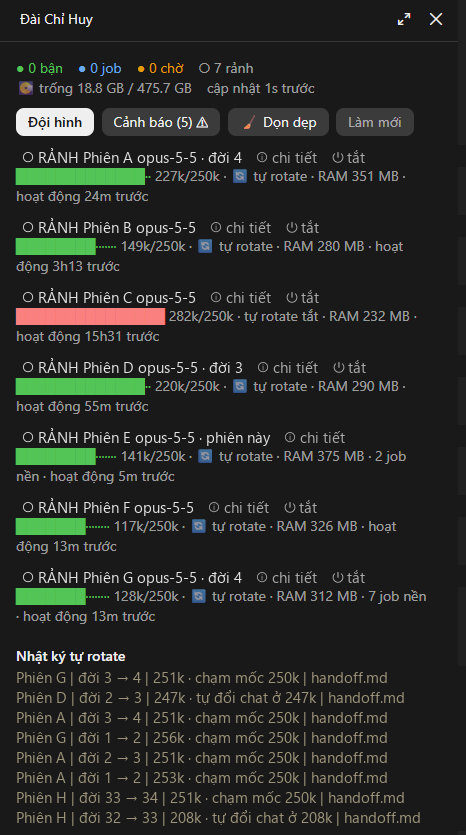
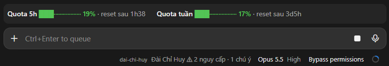
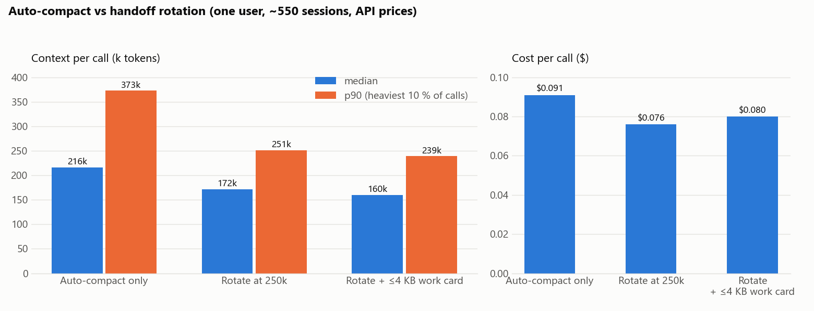
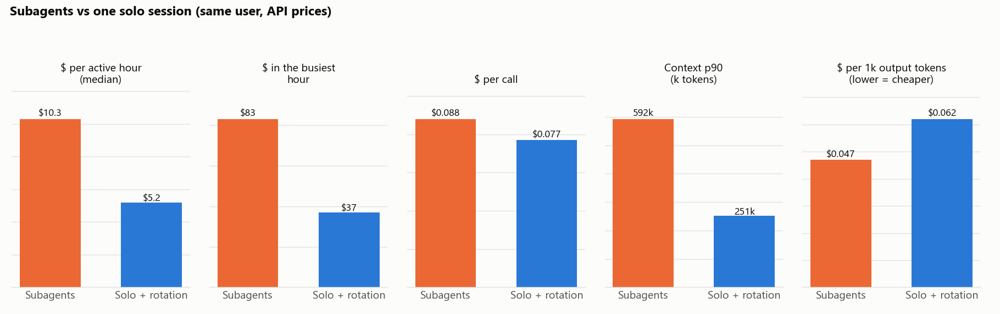

# Đài Chỉ Huy — context rotation for Claude Code (English)

A Claude Code mod (desktop app and terminal, **Windows**) that replaces `/compact` with **handoff files + `/clear`**, and adds a control room for many sessions at once. Vietnamese README: [README.md](README.md).

## Why

Long Claude Code sessions get expensive because every call re-reads the whole context. Auto-compact only kicks in very late (we saw sessions reach 370–600k tokens before compacting), and its summary loses details. This mod rotates the chat at a threshold you pick, after the agent writes a short work card saying exactly what to do and read next.

<p>
  
</p>



*Session names in the screenshots are replaced with Phiên A, B, C... (Vietnamese UI).*

## The numbers

Measured on ~550 Claude Code sessions of one heavy user over a month. Costs use API prices as a relative proxy, not plan limits.

### Auto-compact vs handoff rotation



| | Auto-compact only | Rotate at 250k | Rotate + ≤ 4 KB work card |
|---|---|---|---|
| Context per call, median | 216k | 172k | **160k** |
| Context per call, p90 | 373k | 251k | **239k** |
| Largest context before a reset | 370–600k | ~260k | ~260k |
| Cost per call | $0.091 | **$0.076** | $0.080 |
| What survives a reset | an automatic summary, often missing details | a work card with the exact next step and files to read | same, shorter |

- One reset costs about the same either way (~80–90k tokens rebuilt). The saving comes from the **lower ceiling**: a call at 500k costs ~2.5× a call at 200k.
- Overall, rotated sessions cost **~15–19 % less per call** than compacted ones.

### Subagents vs one solo session



| | Subagents | Solo + rotation |
|---|---|---|
| $ per active hour (median) | $10.3 | **$5.2** |
| $ in the busiest hour | $83 | **$37** |
| $ per call | $0.088 | **$0.077** |
| Context p90 | 592k | **251k** |
| $ per 1k output tokens | **$0.047** | $0.062 |
| $ per working day | ~$110 | ~$103 |
| Cache re-writes after long agent waits | ~$205 | ~$63 |

- Per unit of work (output tokens), subagents are **not** more expensive. What empties the quota is the **burn rate**: parallel agents, each rebuilding its own context, burn twice as much per hour and keep hitting the 5-hour limit.
- Agents that wait (long jobs, the user) past the cache lifetime pay to re-write their cache: about a quarter of the subagent cost.

## What it does

- **Self-rotate.** When a session's context reaches its threshold (250k default; 250 / 350 / 500k per session):
  1. the agent writes a handoff to `~/.claude/dai-chi-huy/handoff/<session name>/<date-time>-<id>.md`. In a long autonomous turn, it is told to stop at a safe point after the next tool result.
  2. when the turn ends and the file exists, the mod runs `/clear` in the same session (old chat stays resumable);
  3. the new chat starts with "read the handoff and continue" (or just summarizes and waits if the handoff says it is waiting for the user).
- **Rotate before waiting.** Before ending a turn to wait for the user, the agent may write the handoff to `~/.claude/dai-chi-huy/request/$CLAUDE_CODE_SESSION_ID.md`; at turn end, if context ≥ 120k, the mod rotates on it.
- **The model picks its own point.** After finishing a step at ≥ ~200k, the agent writes the work card and ends the turn instead of waiting for the hard mark mid-step. Work card ≤ ~4 KB: next task / what to read (and what not to) / state / notes. No history.
- **No subagents.** The `Agent` and `Workflow` tools are refused in every session with the mod. `run_in_background` shell commands still work. This is deliberate: in our data subagents doubled the hourly burn rate and kept hitting the 5-hour limit (see the table above).
- **Quota strip** above the chat box: 5-hour and weekly quota bars with time to reset.
- **Session chips + pane** (`/chihuy`): status, model, context vs threshold, current activity, RAM, background jobs; alerts (context, RAM, silent busy, long tool runs, repeated errors, dead sessions, two sessions editing one file, low disk); stop an idle session to free RAM; cleanup of old transcripts in `~/.claude/projects` with confirmation, a protection window, and a log.

The UI text is Vietnamese.

## Install

Requirements: Windows, Node on `PATH`, a Claude Code build with mod/plugin hooks (`CLAUDE_CODE_PLUGIN_DIRS`).

1. Clone into `~/.claude/mods/dai-chi-huy`.
2. In `~/.claude/settings.json` add:
   ```json
   { "env": { "CLAUDE_CODE_PLUGIN_DIRS": "C:\\Users\\<you>\\.claude\\mods\\dai-chi-huy" } }
   ```
3. Start a new session. Remove the line to uninstall.

Thresholds are plugin config (`rotateK`, `warnK`, `memWarnMb`, `quietBusyMin`, `cleanupDays`, `cleanupProtectHours`); defaults are in `.claude-plugin/plugin.json`. Logs: `~/.claude/dai-chi-huy/rotate.log`, `cleanup.log`.

`scripts/collect.mjs` only reads files and never calls an API; only the cleanup tab deletes, after you confirm. Deletion is permanent.

## Tests

```
claude plugin test .
```

`.claude-plugin/types/` is generated by Claude Code and is not part of this repo.

## License

MIT, see [LICENSE](LICENSE). Not affiliated with Anthropic.
