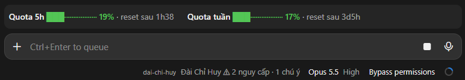
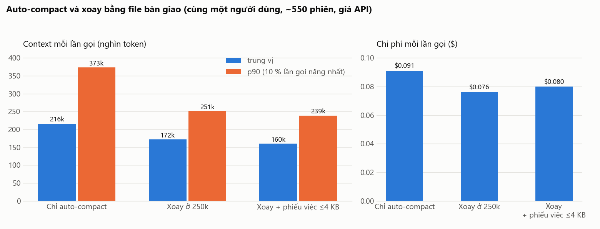
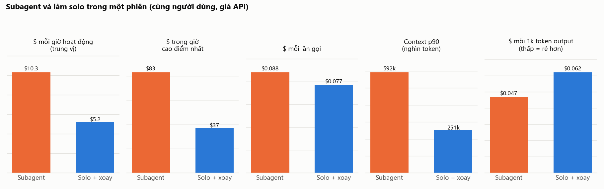

# Đài Chỉ Huy (mod cho Claude Code: app desktop và terminal)

English: [README.en.md](README.en.md) · Giấy phép MIT ([LICENSE](LICENSE)) · Chỉ chạy trên Windows, cần Node trên PATH.

Phòng điều khiển nhiều phiên Claude Code ngay trong app, và tự đổi chat bằng file bàn giao thay cho `/compact`.

  

*Tên phiên trong ảnh đã được thay bằng Phiên A, B, C...*

## Vì sao đáng dùng: số liệu thật

Đo trên khoảng 550 phiên Claude Code của một người dùng nặng trong một tháng. Chi phí tính theo giá API, chỉ để so sánh tương đối, không phải hạn mức của gói.

### Auto-compact và xoay bằng file bàn giao

| | Chỉ auto-compact | Xoay ở 250k | Xoay + phiếu việc ≤ 4 KB |
|---|---|---|---|
| Context mỗi lần gọi, trung vị | 216k | 172k | **160k** |
| Context mỗi lần gọi, p90 | 373k | 251k | **239k** |
| Context lớn nhất trước khi reset | 370–600k | ~260k | ~260k |
| Chi phí mỗi lần gọi | $0.091 | **$0.076** | $0.080 |
| Sau mỗi lần reset còn lại | bản tóm tắt tự động, hay mất chi tiết | phiếu việc ghi đúng bước tiếp và file cần đọc | như trên, ngắn hơn |

- Mỗi lần reset tốn gần bằng nhau ở cả hai cách (nạp lại khoảng 80–90k token). Tiền tiết kiệm đến từ **trần context thấp hơn**: một lần gọi ở 500k đắt khoảng 2,5 lần một lần gọi ở 200k.
- Tính chung, phiên xoay bằng file bàn giao rẻ hơn **khoảng 15–19% mỗi lần gọi** so với phiên bị compact.

### Subagent và làm solo trong một phiên

| | Subagent | Solo + xoay |
|---|---|---|
| $ mỗi giờ hoạt động (trung vị) | $10.3 | **$5.2** |
| $ trong giờ cao điểm nhất | $83 | **$37** |
| $ mỗi lần gọi | $0.088 | **$0.077** |
| Context p90 | 592k | **251k** |
| $ mỗi 1k token output | **$0.047** | $0.062 |
| $ mỗi ngày làm việc | ~$110 | ~$103 |
| Ghi lại cache sau khi agent chờ lâu | ~$205 | ~$63 |

- Tính trên cùng khối lượng việc (token output), subagent **không đắt hơn**. Thứ làm hết quota là **tốc độ đốt**: nhiều agent chạy song song, mỗi con nạp lại context từ đầu, nên đốt gấp đôi mỗi giờ và hay chạm giới hạn 5 giờ.
- Agent ngồi chờ (việc chạy lâu, chờ người dùng) quá lâu thì cache hết hạn và phải ghi lại: khoảng 1/4 chi phí subagent nằm ở đây.

- **Quota 5h và Quota tuần** (dòng đầu của dải trên ô chat): thanh % đã dùng (xanh < 70%, vàng ≥ 70%, đỏ ≥ 90%) và thời gian còn lại tới lúc reset; số lấy từ lần gọi API gần nhất của phiên, cập nhật khi nhích 1 điểm và mỗi 10 giây.
- **Dải trên ô chat**: mỗi phiên một chip (● trạng thái, tên, context). Bấm chip là vào thẳng phiên đó; 📡 mở pane; ⚠ mở pane ở tab Cảnh báo.
- **Pane** (tự mở khi phiên bắt đầu, hoặc `/chihuy`):
  - **Đội hình**: trạng thái, model, thanh context tới ngưỡng rotate, đang làm gì, RAM, job nền, hoạt động lần cuối. Bấm tên phiên để vào thẳng; `ⓘ chi tiết` xem yêu cầu, báo cáo cuối, job nền, copy `claude --resume`, và chọn **mốc rotate riêng** cho phiên đó (250k / 350k / 500k; mốc cảnh báo giữ cùng khoảng cách, 350k → cảnh báo từ 330k), nhớ qua các lần mở sau. Phiên RẢNH (không phải phiên đang mở) có nút `⏻ tắt`: hỏi lại một lần, rồi `taskkill` đúng tiến trình đó để trả RAM; chat vẫn giữ (phiên của app: gửi tin vào là app mở lại; phiên terminal: bấm tên nó để mở lại trong cửa sổ terminal mới); job nền của nó vẫn chạy.
  - **Cảnh báo**: context ≥ mốc xoay hoặc mốc cảnh báo, RAM cao, báo bận mà im lặng, tool chạy lâu ≥ 20 phút, ≥ 3 lỗi trong 30 phút, phiên chết, rảnh ≥ 60 phút, 2 phiên cùng sửa 1 file trong 60 phút, ổ đĩa sắp đầy. Thanh trạng thái hiện số cảnh báo.
  - **🧹 Dọn dẹp**: hội thoại trong `~/.claude/projects` (transcript + thư mục phụ + `file-history`), chọn cũ hơn N ngày, xoá có bước xác nhận. Không bao giờ xoá phiên đang chạy hay file ghi trong `cleanup_protect_hours` giờ qua (kiểm tra lại trên đĩa ngay trước khi xoá); mọi lần xoá ghi vào `~/.claude/dai-chi-huy/cleanup.log`. Xoá là vĩnh viễn.

## Luật: không subagent

Mọi phiên có mod đều bị chặn công cụ `Agent` và `Workflow`: phiên chính tự làm hết (lý do: xem bảng so sánh subagent và solo bên dưới). Agent gọi sẽ bị từ chối kèm lời nhắc; lệnh nền (`run_in_background`) vẫn dùng được.

## Tự rotate

Mỗi phiên có mod tự theo dõi context của chính nó. Khi context ≥ mốc của phiên (mốc chung 250k, hoặc mốc riêng chọn trong `ⓘ chi tiết`):

1. Mod yêu cầu agent viết bàn giao vào `~/.claude/dai-chi-huy/handoff/<tên phiên>/<ngày-giờ>-<id>.md` (mục tiêu, đã xong, đang dở, việc tiếp / CHỜ NGƯỜI DÙNG, lưu ý):
   - hết một lượt: gửi thành một yêu cầu riêng;
   - giữa một lượt dài (agent tự chạy tool liên tục, không dừng): nhắc ngay sau kết quả tool kế tiếp, để agent dừng ở điểm an toàn, viết bàn giao rồi kết thúc lượt. Nếu lượt kết thúc mà chưa có file (ví dụ agent dừng để hỏi), mod gửi lại yêu cầu riêng như trên.
2. Lượt đó xong và file đã có: mod chạy `/clear` ngay trong phiên (cùng dòng sidebar, cùng tên; cuộc chat cũ vẫn resume được).
3. Mod mở cuộc chat mới bằng yêu cầu đọc bàn giao và làm tiếp; nếu bàn giao ghi CHỜ NGƯỜI DÙNG thì chỉ tóm tắt và chờ.

Đổi chat trước khi chờ: trước khi kết thúc một lượt để chờ người dùng duyệt, agent tự viết bàn giao vào `~/.claude/dai-chi-huy/request/$CLAUDE_CODE_SESSION_ID.md`. Hết lượt đó, nếu context ≥ 120k, mod lấy file đó làm bàn giao rồi `/clear` và mở cuộc chat mới như trên; dưới 120k thì bỏ yêu cầu.

Model tự chọn lúc đổi chat: lời nhắc mở chat mới dặn agent khi vừa xong một bước mà context ≥ ~200k thì tự ghi phiếu việc vào file request ở trên rồi kết thúc lượt, thay vì chờ mốc cứng giữa chừng một bước; mốc rotate chỉ còn là lưới an toàn. Bàn giao (cả khi mod yêu cầu) là PHIẾU VIỆC ≤ ~4 KB: Việc tiếp / Đọc gì (+ Không cần đọc) / Trạng thái / Lưu ý, không chép lịch sử.

Mỗi phiên một file bàn giao riêng theo tên phiên, đặt ngoài thư mục dự án, nên nhiều dự án trong cùng một thư mục không ghi đè nhau. Bật/tắt từng phiên trong `ⓘ chi tiết`; nhật ký ở `~/.claude/dai-chi-huy/rotate.log` (hiện cuối tab Đội hình). Lượt bị ngắt hoặc agent không viết file: không `/clear`, thử lại khi context tăng thêm 30k.

Cài cho mọi phiên: thư mục mod nằm ở `~/.claude/mods/dai-chi-huy`, nạp qua `env.CLAUDE_CODE_PLUGIN_DIRS` trong `~/.claude/settings.json` (xoá dòng đó để gỡ).

Bản terminal (chạy `claude` trong terminal trên Windows): dải quota, dòng trạng thái, `/chihuy`, pane (bấm chuột được) và tự rotate chạy như trong app. Phiên terminal không có trang trong app: bấm tên một phiên terminal **đang chạy** chỉ báo nó đang mở ở cửa sổ nào (pid); bấm tên một phiên terminal **đã tắt hoặc chết** sẽ mở một cửa sổ terminal mới chạy `claude --resume <id>` trong thư mục của nó (tạo qua WMI để có môi trường sạch của người dùng, không dính biến của app; không mở được thì copy lệnh). Tên phiên terminal (`game-xx`) do Claude Code đặt lại mỗi lần tiến trình khởi động; qua `/clear` thì giữ nguyên.

Ngưỡng nằm trong cấu hình plugin `dai-chi-huy` (rotateK, warnK, memWarnMb, quietBusyMin, cleanupDays, cleanupProtectHours), mặc định ghi trong `.claude-plugin/plugin.json`.

Dữ liệu do `scripts/collect.mjs` đọc (cần Node trên PATH, Windows): chỉ đọc file, không gọi API; chỉ lệnh xoá trong tab Dọn dẹp ghi hoặc xoá.
