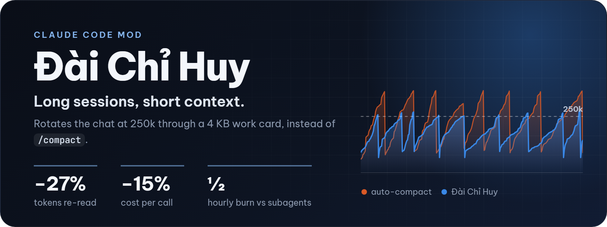
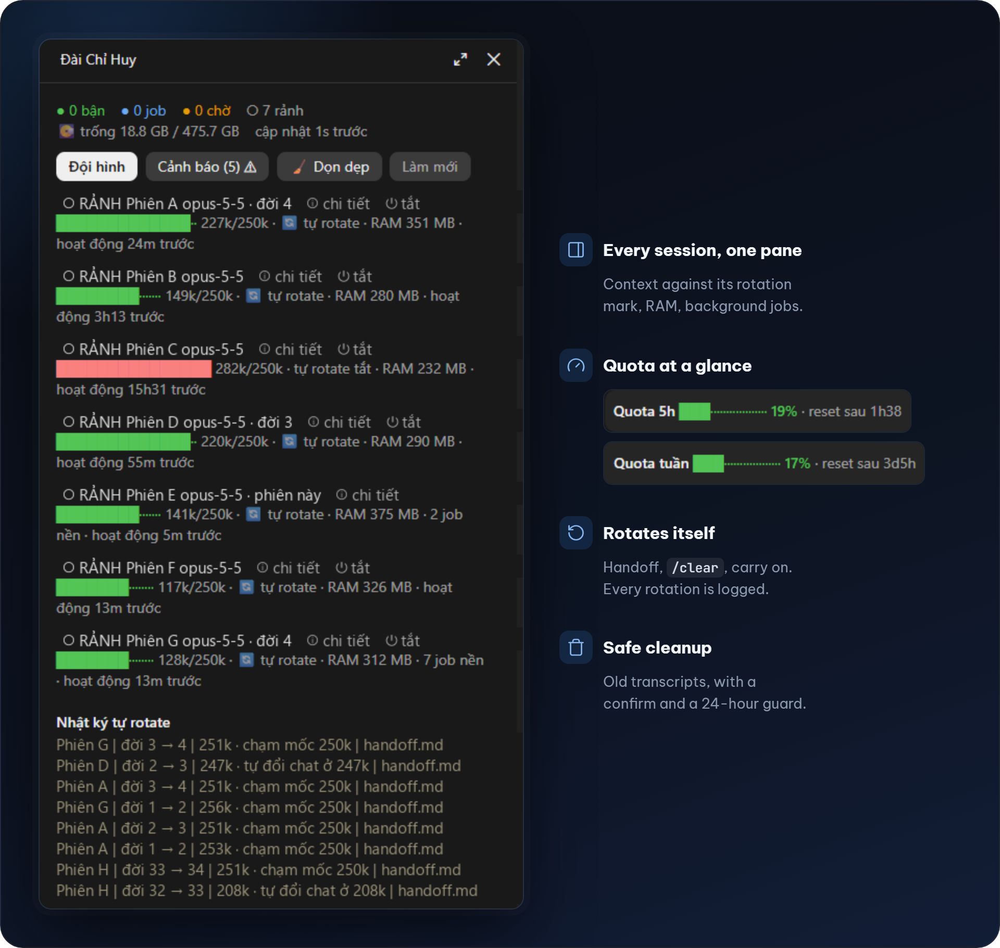
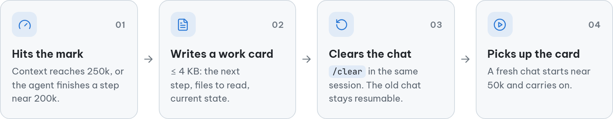
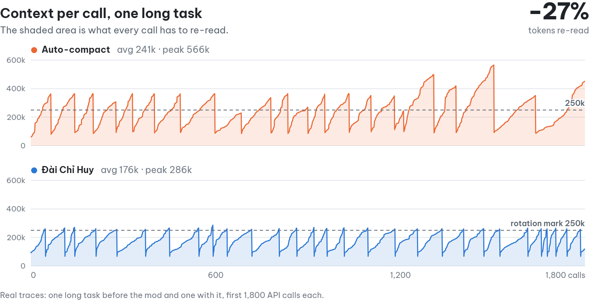
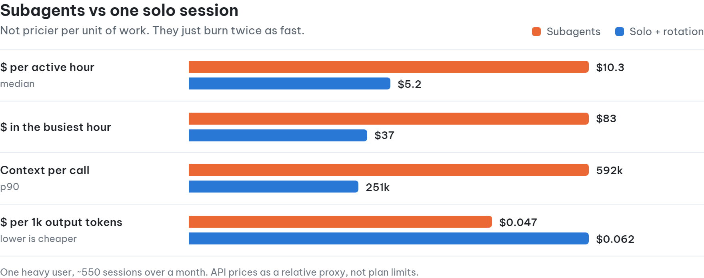

<p align="center">
  
</p>

<p align="center">
  <b>English</b> · <a href="README.vi.md">Tiếng Việt</a>
  <br><br>
  
  
  <a href="LICENSE"></a>
</p>

Every Claude Code call re-reads the whole context, yet auto-compact can wait until 370–600k and then keeps only a lossy summary. Đài Chỉ Huy rotates the chat at 250k instead: the agent writes a 4 KB work card, the mod runs `/clear`, and a fresh chat carries on from the card.



## How it works

<p><picture>
  <source media="(prefers-color-scheme: dark)" srcset="docs/flow.en.dark.png">
  
</picture></p>

## The numbers

<p><picture>
  <source media="(prefers-color-scheme: dark)" srcset="docs/trace.en.dark.png">
  
</picture></p>

<p><picture>
  <source media="(prefers-color-scheme: dark)" srcset="docs/subagents.en.dark.png">
  
</picture></p>

That is why the mod blocks the `Agent` and `Workflow` tools in every session. Background shell commands still run.

## Install

Windows with Node on `PATH`, in the desktop app or the terminal. The interface is in Vietnamese.

```powershell
git clone https://github.com/baconcuu/claude-context-rotate "$HOME\.claude\mods\dai-chi-huy"
```

Add this to `~/.claude/settings.json`, then start a new session. The pane opens on its own, or run `/chihuy`.

```json
{ "env": { "CLAUDE_CODE_PLUGIN_DIRS": "C:\\Users\\<you>\\.claude\\mods\\dai-chi-huy" } }
```

Remove the line to uninstall.

<details>
<summary><b>Settings</b></summary>
<br>

Plugin config for `dai-chi-huy`. Defaults live in `.claude-plugin/plugin.json`.

| Setting | Default | Meaning |
|---|---|---|
| `rotateK` | 250 | Rotation mark, k tokens |
| `warnK` | 230 | Context warning, k tokens |
| `memWarnMb` | 1500 | RAM warning per session, MB |
| `quietBusyMin` | 15 | Warn when a busy session stays silent this many minutes |
| `cleanupDays` | 7 | Cleanup preselects transcripts older than this many days |
| `cleanupProtectHours` | 24 | Cleanup never deletes anything written in this many hours |

Each session can turn rotation off or pick its own mark (250, 350 or 500k) under `ⓘ chi tiết` in the pane. Every rotation goes to `~/.claude/dai-chi-huy/rotate.log`, every deletion to `cleanup.log`.

`scripts/collect.mjs` only reads files and never calls an API. Only the Cleanup tab deletes, after you confirm, and deletion is permanent.

Tests: `claude plugin test .`

</details>

<details>
<summary><b>All numbers</b></summary>
<br>

About 550 sessions of one heavy user over a month. Costs use API prices as a relative proxy, not plan limits.

| | Auto-compact only | Rotate at 250k | Rotate + ≤ 4 KB work card |
|---|---|---|---|
| Context per call, median | 216k | 172k | **160k** |
| Context per call, p90 | 373k | 251k | **239k** |
| Largest context before a reset | 370–600k | ~260k | ~260k |
| Cost per call | $0.091 | **$0.076** | $0.080 |
| What survives a reset | an automatic summary, often missing details | a work card with the exact next step and files to read | same, shorter |

| | Subagents | Solo + rotation |
|---|---|---|
| $ per active hour (median) | $10.3 | **$5.2** |
| $ in the busiest hour | $83 | **$37** |
| $ per call | $0.088 | **$0.077** |
| Context p90 | 592k | **251k** |
| $ per 1k output tokens | **$0.047** | $0.062 |
| $ per working day | ~$110 | ~$103 |
| Cache re-writes after long agent waits | ~$205 | ~$63 |

</details>

<p align="center"><sub><a href="LICENSE">MIT</a> · Not affiliated with Anthropic</sub></p>
