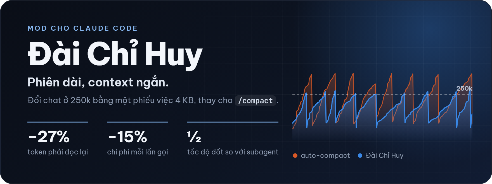
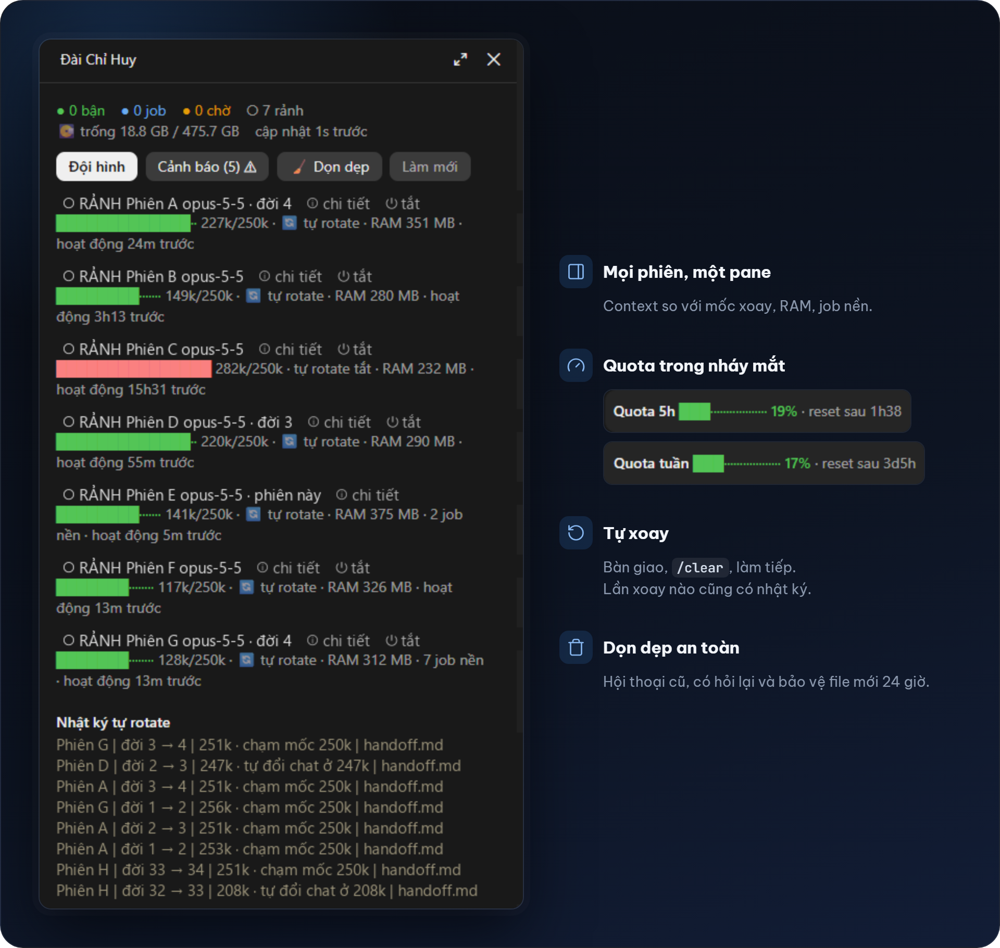
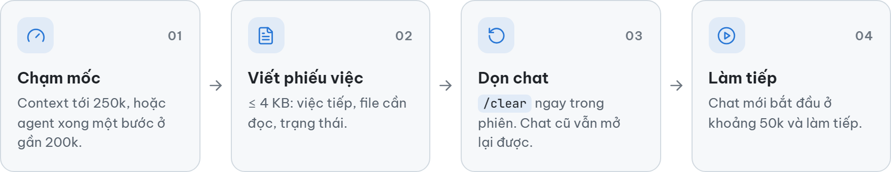
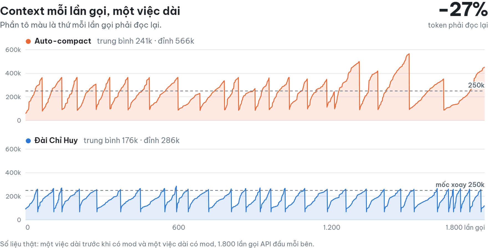
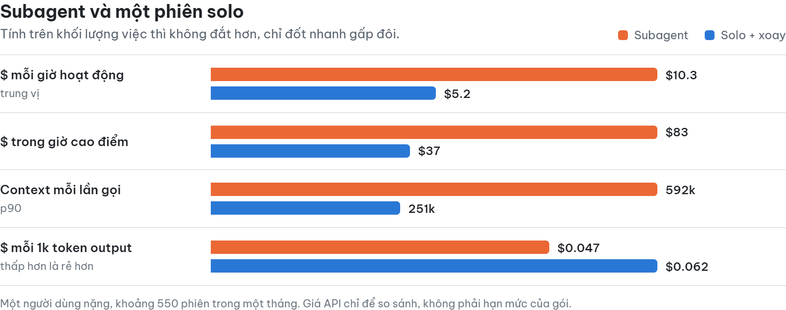

<p align="center">
  
</p>

<p align="center">
  <a href="README.md">English</a> · <b>Tiếng Việt</b>
  <br><br>
  
  
  <a href="LICENSE"></a>
</p>

Mỗi lần gọi, Claude Code đọc lại toàn bộ context, mà auto-compact có khi chờ tới 370–600k rồi chỉ giữ lại một bản tóm tắt hay sót chi tiết. Đài Chỉ Huy đổi chat ở 250k: agent viết một phiếu việc 4 KB, mod chạy `/clear`, chat mới đọc phiếu và làm tiếp.



## Cách hoạt động

<p><picture>
  <source media="(prefers-color-scheme: dark)" srcset="docs/flow.vi.dark.png">
  
</picture></p>

## Số liệu

<p><picture>
  <source media="(prefers-color-scheme: dark)" srcset="docs/trace.vi.dark.png">
  
</picture></p>

<p><picture>
  <source media="(prefers-color-scheme: dark)" srcset="docs/subagents.vi.dark.png">
  
</picture></p>

Vì vậy mod chặn công cụ `Agent` và `Workflow` ở mọi phiên. Lệnh nền vẫn chạy bình thường.

## Cài đặt

Cần Windows và Node trên `PATH`; chạy được trong app desktop lẫn terminal. Giao diện tiếng Việt.

```powershell
git clone https://github.com/baconcuu/claude-context-rotate "$HOME\.claude\mods\dai-chi-huy"
```

Thêm đoạn này vào `~/.claude/settings.json` rồi mở phiên mới. Pane tự mở, hoặc gõ `/chihuy`.

```json
{ "env": { "CLAUDE_CODE_PLUGIN_DIRS": "C:\\Users\\<tên bạn>\\.claude\\mods\\dai-chi-huy" } }
```

Xoá dòng đó để gỡ.

<details>
<summary><b>Cấu hình</b></summary>
<br>

Cấu hình plugin `dai-chi-huy`. Giá trị mặc định nằm trong `.claude-plugin/plugin.json`.

| Khoá | Mặc định | Ý nghĩa |
|---|---|---|
| `rotateK` | 250 | Mốc xoay, k token |
| `warnK` | 230 | Mốc cảnh báo context, k token |
| `memWarnMb` | 1500 | Cảnh báo RAM mỗi phiên, MB |
| `quietBusyMin` | 15 | Cảnh báo khi phiên báo bận mà im lặng quá số phút này |
| `cleanupDays` | 7 | Dọn dẹp chọn sẵn hội thoại cũ hơn số ngày này |
| `cleanupProtectHours` | 24 | Dọn dẹp không bao giờ xoá thứ gì ghi trong số giờ này |

Mỗi phiên có thể tắt tự xoay hoặc chọn mốc riêng (250, 350 hoặc 500k) ở `ⓘ chi tiết` trong pane. Lần xoay nào cũng ghi vào `~/.claude/dai-chi-huy/rotate.log`, lần xoá nào cũng ghi vào `cleanup.log`.

`scripts/collect.mjs` chỉ đọc file, không gọi API. Chỉ tab Dọn dẹp mới xoá, sau khi bạn xác nhận, và xoá là vĩnh viễn.

Chạy test: `claude plugin test .`

</details>

<details>
<summary><b>Toàn bộ số liệu</b></summary>
<br>

Khoảng 550 phiên của một người dùng nặng trong một tháng. Chi phí tính theo giá API, chỉ để so sánh tương đối, không phải hạn mức của gói.

| | Chỉ auto-compact | Xoay ở 250k | Xoay + phiếu việc ≤ 4 KB |
|---|---|---|---|
| Context mỗi lần gọi, trung vị | 216k | 172k | **160k** |
| Context mỗi lần gọi, p90 | 373k | 251k | **239k** |
| Context lớn nhất trước khi reset | 370–600k | ~260k | ~260k |
| Chi phí mỗi lần gọi | $0.091 | **$0.076** | $0.080 |
| Sau mỗi lần reset còn lại | bản tóm tắt tự động, hay mất chi tiết | phiếu việc ghi đúng bước tiếp và file cần đọc | như trên, ngắn hơn |

| | Subagent | Solo + xoay |
|---|---|---|
| $ mỗi giờ hoạt động (trung vị) | $10.3 | **$5.2** |
| $ trong giờ cao điểm nhất | $83 | **$37** |
| $ mỗi lần gọi | $0.088 | **$0.077** |
| Context p90 | 592k | **251k** |
| $ mỗi 1k token output | **$0.047** | $0.062 |
| $ mỗi ngày làm việc | ~$110 | ~$103 |
| Ghi lại cache sau khi agent chờ lâu | ~$205 | ~$63 |

</details>

<p align="center"><sub><a href="LICENSE">MIT</a> · Không liên kết với Anthropic</sub></p>
